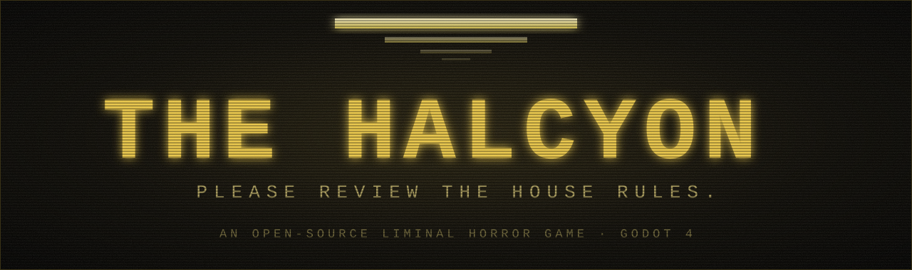
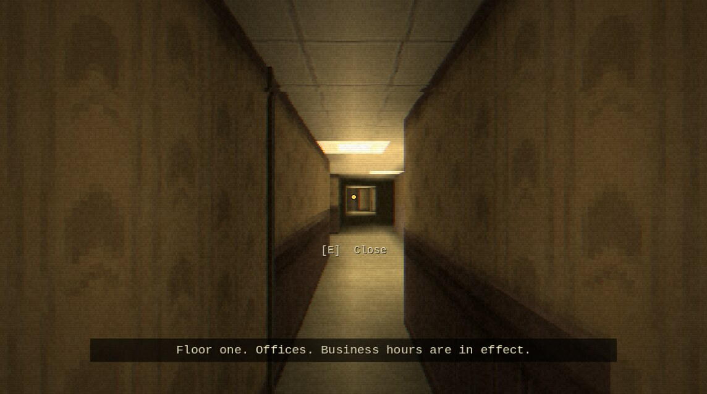
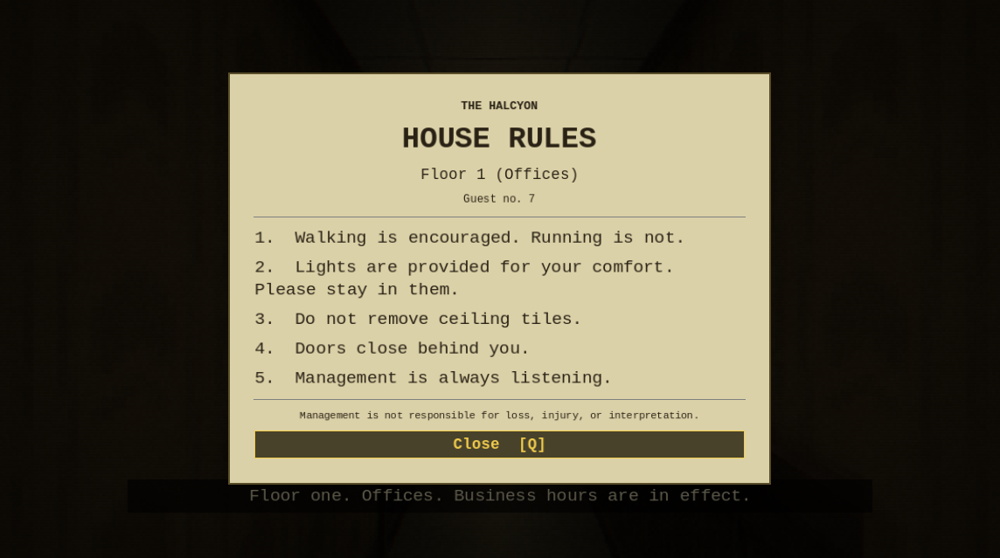
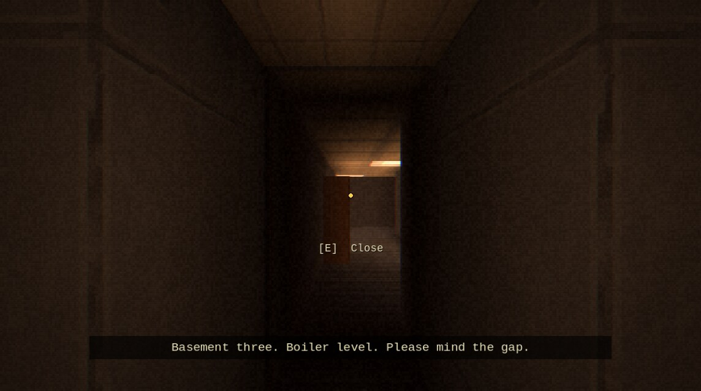
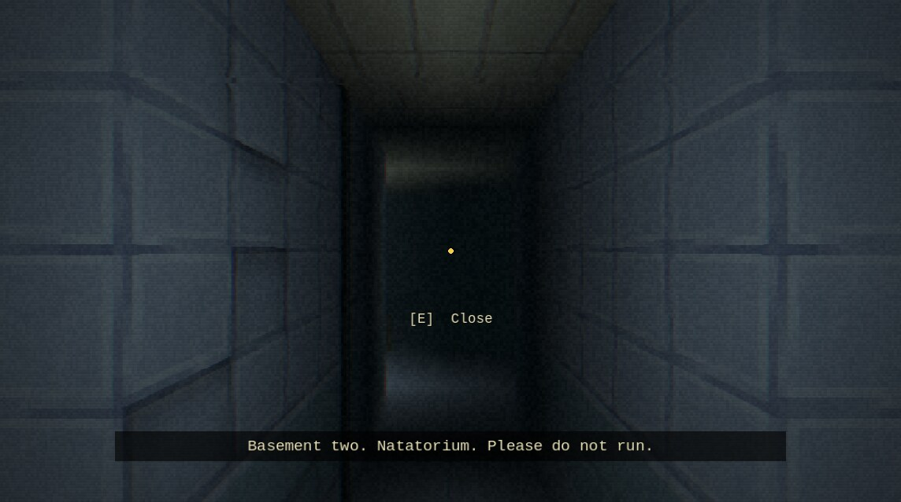
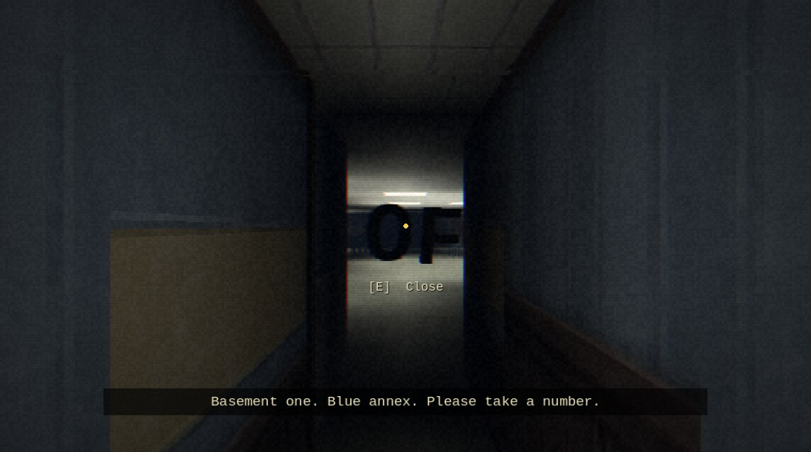
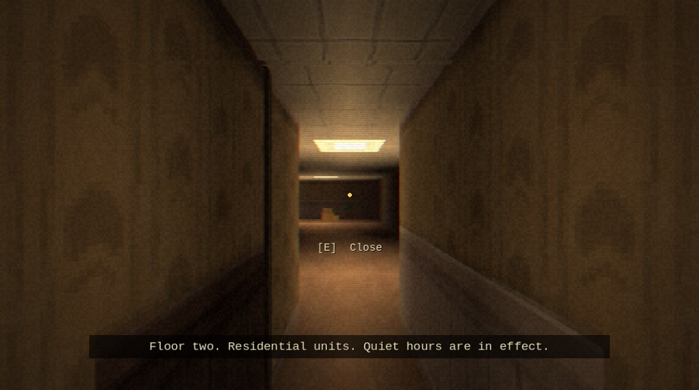
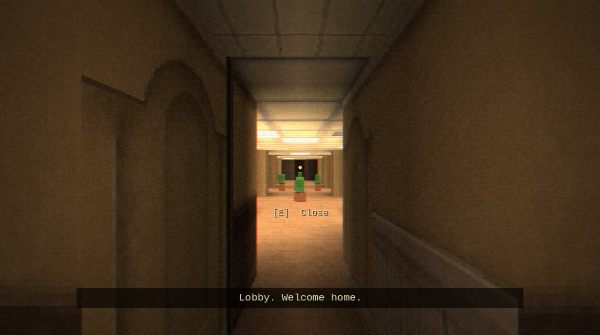
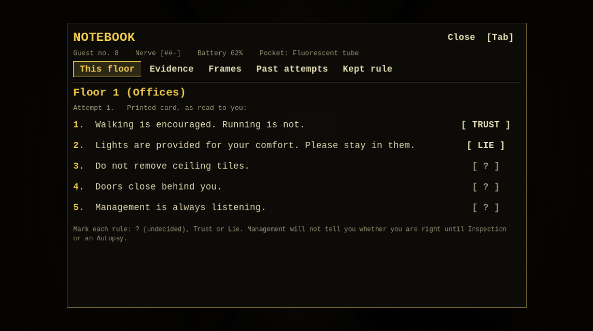

<div align="center">



<br>

[](LICENSE)
[](https://godotengine.org)
[](#how-its-built)
[](#development)
[](#contributing)

**A free, open-source Backrooms-style liminal horror game made with Godot 4.**<br>
Endless fluorescent corridors. A hotel that has always been a hotel.<br>
A polite voice on the PA that may be lying to you.

[**Play it**](#run-it) · [**The hook**](#the-hook-the-rules-can-lie) · [**Floors**](#six-floors-six-instincts) · [**Make a room**](#making-a-room) · [**Learn from the code**](#learn-from-the-code) · [**Credits**](#credits)

</div>

<br>

<p align="center">
  
</p>

---

## Welcome to The Halcyon

You wake at the bottom of a hotel-slash-office-block that is **much too hospitable**. A warm, bureaucratic voice called **Management** welcomes you and hands you a laminated card of **House Rules**. On every floor, one of those rules tells you how to survive the thing that lives there.

**The rules are advice, and advice can lie.**

There is no combat, no XP and no inventory grid. You walk, look, open doors, read the card and raise your camcorder. The only thing that progresses is **what you know**.

If you like Backrooms-style liminal spaces, "follow the posted rules or else" horror in the vein of DOORS, and found-footage dread, this is a small, hackable, fully scripted take on all three. Every room is a text file you can edit.

> [!NOTE]
> **Status:** all six floors, the entities, endings, menus, settings and saves are implemented and covered by automated tests (headless bots walk every floor to the exit, both ways the rules can lie). The **Yellow floor** is the polished vertical slice. The other floors, the audio mix and the pacing have **not had a human playtest yet**, so expect rough edges. Issues and PRs are very welcome.

<br>

## The hook: the rules can lie

<table>
<tr>
<td width="46%" valign="top">



</td>
<td valign="top">

Each floor has **exactly one entity**, and one rule on the card describes how to deal with it.

In any given run that rule is either **true** or **inverted**. Obeying it blindly is a coin flip. The way to win is to **deduce** which one it is from evidence in the world: scratches, stickers, dead lights, the way a door was left.

> ***The house can lie in what it says, never in what it shows.***

That is the **fairness law**. Anything physically present in the building is always true for the current run. Only the voice and the card can deceive.

Every floor tests a different human instinct: *run, freeze, wait, seek the light, answer, obey.* The card always tells you to do the instinctive thing. Sometimes that is right.

</td>
</tr>
</table>

<br>

## Six floors, six instincts

<table>
<tr>
<td align="center" width="33%"><br><b>B3 · Boiler Rooms</b><br><sub>The Foreman · <i>Run</i></sub></td>
<td align="center" width="33%"><br><b>B2 · Natatorium</b><br><sub>The Lifeguard · <i>Freeze</i></sub></td>
<td align="center" width="33%"><br><b>B1 · Blue Annex</b><br><sub>The Queue · <i>Wait</i></sub></td>
</tr>
<tr>
<td align="center"><br><b>1F · Yellow Offices</b><br><sub>The Hum · <i>Seek the light</i></sub></td>
<td align="center"><br><b>2F · Residential Units</b><br><sub>The Greeter · <i>Answer</i></sub></td>
<td align="center"><br><b>L · The Lobby</b><br><sub>Management &amp; the Audit · <i>Obey</i></sub></td>
</tr>
</table>

<sub>Screenshots are captured from the game itself (low-res render with the camcorder filter) with the Dread Director turned off, so nothing is lurking in these frames. Probably.</sub>

<br>

## What's in the box

<table>
<tr>
<td width="55%" valign="top">

- 📼 **Camcorder with a 45-second rewind buffer.** Raise it to light the dark, replay what you missed, freeze a frame for your notebook. It narrows your vision while it is up.
- 📓 **A notebook that survives your death.** It lists only evidence that is true for the current run, and never tells you which rule is real.
- 🎥 **Stakeout:** set the camcorder down and let it watch a door for you.
- 💡 **Bulb:** a pocket item that moves a light, so you can *test* what the dark does.
- 🚪 **Peek and brace** on doors, the most-used object in the game.
- ⚖️ **Verdict:** one Suggestion Box per floor. File what you believe, earn a reward or take a penalty.
- 📜 **The Clause:** from floor 2 you may carry one true rule across floors.
- 🧹 **Housekeeping:** a soft floor timer with a face. A cart works its way toward you.
- 🎭 **Dread Director:** paces tells, scares and relief so a floor breathes instead of spamming.
- 🎬 **Three endings**, and tapes of how you died.
- 🧱 Streamed floors built from **hand-authored ASCII rooms**, a low-res pixel look, keyboard/mouse and gamepad.

</td>
<td valign="top">

<br>
<sub>The notebook. You mark each rule <b>Trust</b> or <b>Lie</b>. Management will not tell you whether you were right until Inspection.</sub>

</td>
</tr>
</table>

<br>

## Run it

You need **Godot 4.7.x** (developed on 4.7.2) with the **GL Compatibility** renderer. No addons, no external dependencies.

```bash
git clone https://github.com/kentgarcia/the-halcyon.git
cd the-halcyon
godot --headless --path . --import   # first time only: builds the import cache
godot --path .                       # play
```

Or open the folder in the Godot editor and press F5.

### Controls

| Action | Keyboard / mouse | Gamepad |
|---|---|---|
| Move / look | WASD or arrows / mouse | Left stick / right stick |
| Sprint / crouch | Shift / Ctrl or C | L-stick click / B |
| Interact | E | A |
| Raise camcorder | Right mouse | Left trigger |
| Freeze frame | Left mouse (camcorder up) | Right trigger |
| Playback (rewind) | R | Right bumper |
| Lamp | F | Left bumper |
| Stakeout | G | D-pad down |
| Use pocket item | X | X |
| House Rules card | Q | Y |
| Notebook | Tab | Back |
| Pause | Esc | Start |

## Development

Everything goes through [`dev.sh`](dev.sh). It finds Godot from `$GODOT`, then a one-line `.godot_bin` file (git-ignored), then `godot` on your `PATH`.

```bash
./dev.sh import            # refresh the class cache (after adding any file with class_name)
./dev.sh check             # parse-check every script
./dev.sh test [filter]     # run tests/test_*.gd headlessly
./dev.sh floors [seed]     # a bot walks every floor to the exit, both truths
./dev.sh soak [n]          # generate n floors per floor and check fairness/solvability
./dev.sh smoke             # boot the main scene headless and fail on script errors
./dev.sh shot floor out.png 240 --floor=yellow --seed=3   # windowed screenshot of a dev scene
./dev.sh run               # run the game windowed
./dev.sh export            # Linux release build + a smoke run of the exported binary
```

Without the script, the tests are just `godot --headless --path . res://tests/test_runner.tscn -- --filter=<name>`.

The developer harness (`tools/dev/`, command-line scenes, bots and screenshots) only loads when you pass user args after `--` and the folder exists, so a build without `tools/` runs as a normal game.

### How it's built

```
autoload/   EventBus, Settings, SaveService, RunState, AudioDirector, DreadDirector, Game (run orchestration)
core/       GameScale (all dimensions), PlayerInput component, input setup
world/      ASCII chunk parser/builder, streamer, door grammar, tile-grid pathfinding, props
game/       FloorSession, FloorPlan, DirectorCore, Housekeeping, Echo (camcorder tape) playback
entities/   the six entities, silhouettes and shared staff kit
content/    FloorDef / RuleDef / EvidenceDef resources, themes, door types, and the .chunk rooms
ui/         HUD, screens (menu, card, notebook, pause, settings, endings...), sound radar
audio/      generated ambience, SFX, music and Management's PA voice (+ manifest.json)
tests/      headless test suite (lint, geometry, floor soak, entities, UI screens)
tools/      dev harness and bots, audio generators (Python), local MCP installs for Blockbench
```

House rules for the code (the tests enforce several):

- **No global `randf()` / `randi()`.** Gameplay randomness uses named RNG streams on `RunState`, derived from the run seed, so a seed always reproduces a run.
- **All dimensions come from `GameScale`:** one tile is 1.25 m and every room is 2.5 m tall. No magic numbers.
- **Gameplay code never reads `Input` directly.** It goes through the `PlayerInput` component (gamepad now, mobile and co-op later).
- Typed GDScript. Content is `Resource`-driven and tunables live in resources.
- Materials by library name, never by raw texture path. Mobile-safe budget: at most 6 real lights, lamp-only shadows, alpha-scissor instead of blend, low-res render viewport.
- The fairness law above is a hard rule: never make the world show something false.

Comments in the code occasionally cite `SPEC §n`. That is the original design document, which is not part of this repository.

### Making a room

Rooms are plain-text `.chunk` files in `content/chunks/<group>/`. One character is one tile (1.25 m); walls are 2.5 m. This is a real room, `content/chunks/natatorium/nat_closet_towels.chunk`:

```
; Towel store.
id: nat_closet_towels         ; globally unique; prefix = group
beat: side                    ; arrival | choice | long | exam | rest | departure | side
floors: natatorium            ; comma list; empty = usable on every floor
tags: closet
weight: 1.0
max_per_floor: 1
ceiling: large
decay: 0
---
#########
#.L..z.i#
#H.....z#
4.......#
#.i....H#
#########
```

The `4` on the west edge is an **entry** door (where you arrive from), `L` is a lit ceiling panel, `H` a locker you can hide in, `z` boxes and `i` a loot item.

| Char | Meaning | Char | Meaning |
|---|---|---|---|
| `#` / space | wall / void | `.` `,` | floor / worn floor |
| `L` `l` `S` | light panel: lit / dead / switchable | `P` | pillar |
| `^ > v <` | **exit** door (N/E/S/W) | `1 2 3 4` | **entry** door (N/E/S/W) |
| `g` | graffiti (evidence host) | `h` `H` | desk / wardrobe you can hide in |
| `b` `s` | breaker box / light switch | `x` `r` | suggestion box / charger |
| `u` | spawn / entity anchor | `i` `t` | loot item / tape pickup |
| `z` `d` `k` | boxes / desk / filing cabinet | `m` `p` `e` | PA horn / poster / vent |

The full legend, the per-beat contract (an arrival room must contain a spawn, rest rooms must be fully lit and have a charger, and so on) and the sockets rules are in the comments of `world/chunk_spec.gd` and enforced by `tests/test_chunk_library.gd`. Run `./dev.sh test chunk` after adding a room, and `./dev.sh shot chunkview out.png 60 --chunk=<your_room_id> --view=top` to look at it.

## Learn from the code

New to Godot, or looking for a **Godot 4 horror game template** or an open-source **Backrooms game** to read? This project is deliberately small, typed and tested. Good places to start:

| If you want to learn... | Read |
|---|---|
| **Procedural, streamed level generation** from hand-made rooms (rooms load as doors open and unload behind you) | [`world/chunk_streamer.gd`](world/chunk_streamer.gd), [`world/chunk_placer.gd`](world/chunk_placer.gd), [`game/floor_plan.gd`](game/floor_plan.gd) |
| **Building 3D rooms in code** from a text grid (walls, doors, thin walls, light panels) | [`world/chunk_spec.gd`](world/chunk_spec.gd), [`world/chunk_builder.gd`](world/chunk_builder.gd) |
| **A horror "AI director"** that paces tells, scares and relief | [`game/director_core.gd`](game/director_core.gd), [`autoload/dread_director.gd`](autoload/dread_director.gd) |
| **A found-footage camcorder**: rolling rewind buffer, playback, freeze frames | [`core/tape_buffer.gd`](core/tape_buffer.gd), [`player/camcorder.gd`](player/camcorder.gd), [`game/echo_player.gd`](game/echo_player.gd) |
| **A low-res retro / PSX-style look** in Godot (SubViewport, nearest filtering, tape shader) | [`main.gd`](main.gd), [`shaders/`](shaders/) |
| **Rule-based deduction design**: true/inverted rules, fair evidence, seeded runs | [`autoload/run_state.gd`](autoload/run_state.gd), [`content/floor_catalog.gd`](content/floor_catalog.gd), [`game/evidence_tracker.gd`](game/evidence_tracker.gd) |
| **Seeded, reproducible randomness** with named RNG streams | [`core/rng_streams.gd`](core/rng_streams.gd) |
| **An input layer** that keeps gameplay off `Input` (gamepad now, mobile/co-op later) | [`core/components/player_input.gd`](core/components/player_input.gd), [`core/input_setup.gd`](core/input_setup.gd) |
| **Entities with fair, testable behaviour** | [`entities/`](entities/) |
| **Headless testing and bots in Godot** (a bot that walks every floor to the exit) | [`tests/`](tests/), [`tools/dev/bots.gd`](tools/dev/bots.gd) |
| **Procedural audio** (ambience, SFX and a PA voice generated by scripts) | [`tools/audio/`](tools/audio/), [`autoload/audio_director.gd`](autoload/audio_director.gd) |
| **Menus, save files, settings, accessibility** | [`ui/screens/`](ui/screens/), [`autoload/save_service.gd`](autoload/save_service.gd), [`autoload/settings.gd`](autoload/settings.gd) |

<br>

## Contributing

Bug reports, new rooms, new floors, evidence ideas and playtest notes are all welcome. Please:

1. Run `./dev.sh check` and `./dev.sh test` before opening a PR.
2. Keep the code rules above (especially RNG streams, `GameScale` and `PlayerInput`).
3. For anything that touches the rules or evidence system, keep the fairness law intact.

**Good first contributions:** new `.chunk` rooms, a human playtest report for a floor that has not had one, scares that are designed but not built yet (*wrong floor*, *your handwriting*, *someone moved it*), and audio replacements.

<br>

## FAQ

**Is this the Backrooms?** It is inspired by the liminal-space and "Backrooms" internet genre: empty offices, wrong hotels, humming lights, nobody home. It is an original game with its own setting and rules, not an adaptation of any film or game.

**Is it finished?** It is complete end to end but young. See the status note at the top.

**Can I use it as a template for my own liminal horror game?** Yes. It is MIT licensed. Swap the floors, rules and rooms, or keep the engine pieces (room streaming, director, camcorder, tests).

**Does it run on mobile?** Desktop first. The renderer settings are kept mobile-safe (GL Compatibility, few real lights, no alpha blending, low-res viewport) so a mobile port is realistic, but there is no mobile build yet.


<br>

## Credits

Code and game content: MIT, see [LICENSE](LICENSE). Third-party material:

| What | By | License | Link |
|---|---|---|---|
| **Retro Textures: Liminal** (wall, floor, ceiling and door textures in `assets/third_party/kenney_retro_liminal/`) | Kenney | CC0 1.0 | [kenney.nl/assets/retro-textures-liminal](https://kenney.nl/assets/retro-textures-liminal) · [OpenGameArt mirror](https://opengameart.org/content/retro-textures-liminal) · [license text](https://creativecommons.org/publicdomain/zero/1.0/) |
| **Liberation Mono** (UI font, `fonts/`) | Red Hat / Liberation Fonts project (Digitized data © Google Corporation) | SIL Open Font License 1.1 | [github.com/liberationfonts/liberation-fonts](https://github.com/liberationfonts/liberation-fonts) · [OFL 1.1](https://openfontlicense.org) |
| **Godot Engine** | Godot contributors | MIT | [godotengine.org](https://godotengine.org) |
| **Flite** + the CMU ARCTIC `slt` voice (synthesizes Management's PA lines before they are run through a PA processing chain) | Carnegie Mellon University | BSD-style, see the projects | [github.com/festvox/flite](https://github.com/festvox/flite) · [festvox.org/cmu_arctic](http://festvox.org/cmu_arctic/) |

The ambience, sound effects and music in `audio/` are synthesized by the Python scripts in `tools/audio/`. No recorded samples are used.

*The Halcyon* is inspired by the liminal-space and "Backrooms" internet genre and by rule-based horror games. It is an independent fan-spirited project and is not affiliated with or endorsed by the makers of any film, game or franchise in that space.

---

<sub><b>Keywords:</b> backrooms game, free backrooms game, open source backrooms game, liminal space game, liminal horror, liminal spaces, godot horror game, godot 4 horror game template, godot 4 first person horror, gdscript horror game, procedural level generation godot, rule-based horror game, DOORS-like game, found footage horror, camcorder horror game, retro low-poly PSX horror, analog horror, indie horror game, open source game, game dev learning project.</sub>
