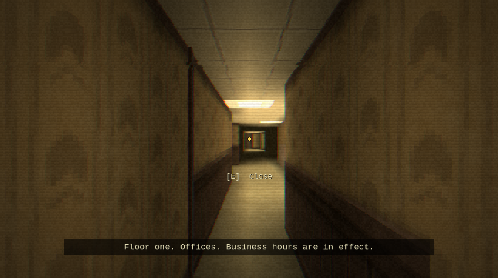

# The Halcyon

**An open-source liminal horror game for Godot 4.** Endless fluorescent corridors, a hotel that has always been a hotel, and a polite voice on the PA that may be lying to you.

<p align="center">
  <br>
  <sub>Floor 1 (Offices), rendered at low resolution with the camcorder filter.</sub>
</p>

Walk, look, open doors, read the card, raise the camcorder. There is no combat, no XP and no inventory grid. The only thing that progresses is **what you know**.

If you like backrooms-style liminal spaces and rule-based horror (think "follow the posted rules or else"), this is a small, hackable, fully scripted take on that genre. Every room is a text file you can edit.

> **Status:** all six floors, the entities, endings, menus, settings and saves have a first implementation and pass the automated tests (headless bots walk every floor to the exit). The **Yellow floor** is the polished vertical slice. The other floors, the audio mix and the pacing have **not had a human playtest yet**, so expect rough edges. Issues and PRs are very welcome.

## The hook: the rules can lie

You arrive at the bottom of The Halcyon, a hotel-slash-office-block that is much too hospitable. A warm, bureaucratic PA voice called **Management** hands you a card of **House Rules** on every floor. Each floor has exactly one entity, and one rule on the card describes how to deal with it.

In any given run that rule is either **true** or **inverted**. Following a rule blindly is a coin flip. The way to win is to *deduce* which it is from evidence in the world: scratches, stickers, dead lights, the way a door was left.

**The fairness law:** *the house can lie in what it **says**, never in what it **shows**.* Anything physically present in the building is always true for the current run. Only the voice and the card can deceive. Every floor tests a different human instinct (run, freeze, wait, seek the light, answer, obey), and the card always tells you to do the instinctive thing. Sometimes that is right.

## What's in the box

| Floor | Place | Entity | Instinct tested |
|---|---|---|---|
| B3 | Boiler Rooms | The Foreman | Run |
| B2 | Natatorium | The Lifeguard | Freeze |
| B1 | Blue Annex | The Queue | Wait |
| 1F | Yellow Offices | The Hum | Seek the light |
| 2F | Units (residential) | The Greeter | Answer |
| L | The Lobby | Management / the Audit | Obey |

- **Camcorder with a 45-second rewind buffer.** Raise it to light the dark, replay what you missed, freeze a frame for your notebook. It narrows your vision while it is up.
- **Notebook that persists across deaths.** It lists only evidence that is true for the current run, and never tells you which rule is the real one.
- **Stakeout:** set the camcorder down and let it watch a door for you.
- **Bulb:** a pocket item that moves a light, so you can *test* what the dark does.
- **Peek and brace** on doors, the most-used object in the game.
- **Verdict:** one Suggestion Box per floor. File what you believe, earn a reward or take a penalty.
- **The Clause:** from floor 2 you may keep one true rule from the card across floors.
- **Housekeeping:** a soft floor timer with a face (a cart that works its way toward you).
- **Dread Director:** paces tells, scares and relief so a floor breathes instead of spamming.
- **Three endings**, and own-death tapes of how you died.
- Procedurally streamed floors built from hand-authored ASCII rooms, a low-res pixel look (nearest filtering, alpha-scissor, a handful of real lights), keyboard/mouse and gamepad support.

## Run it

You need **Godot 4.7.x** (developed on 4.7.2) with the **GL Compatibility** renderer. No addons, no external dependencies.

```bash
git clone https://github.com/kentgarcia/the-halcyon.git
cd the-halcyon
godot --headless --path . --import   # first time only: builds the import cache
godot --path .                       # play
```

Or open the folder in the Godot editor and press F5.

### Controls

| Action | Keyboard / mouse | Gamepad |
|---|---|---|
| Move / look | WASD or arrows / mouse | Left stick / right stick |
| Sprint / crouch | Shift / Ctrl or C | L-stick click / B |
| Interact | E | A |
| Raise camcorder | Right mouse | Left trigger |
| Freeze frame | Left mouse (camcorder up) | Right trigger |
| Playback (rewind) | R | Right bumper |
| Lamp | F | Left bumper |
| Stakeout | G | D-pad down |
| Use pocket item | X | X |
| House Rules card | Q | Y |
| Notebook | Tab | Back |
| Pause | Esc | Start |

## Development

Everything goes through [`dev.sh`](dev.sh). It finds Godot from `$GODOT`, then a one-line `.godot_bin` file (git-ignored), then `godot` on your `PATH`.

```bash
./dev.sh import            # refresh the class cache (after adding any file with class_name)
./dev.sh check             # parse-check every script
./dev.sh test [filter]     # run tests/test_*.gd headlessly
./dev.sh floors [seed]     # a bot walks every floor to the exit, both truths
./dev.sh soak [n]          # generate n floors per floor and check fairness/solvability
./dev.sh smoke             # boot the main scene headless and fail on script errors
./dev.sh shot floor out.png 240 --floor=yellow --seed=3   # windowed screenshot of a dev scene
./dev.sh run               # run the game windowed
./dev.sh export            # Linux release build + a smoke run of the exported binary
```

Without the script, the tests are just `godot --headless --path . res://tests/test_runner.tscn -- --filter=<name>`.

The developer harness (`tools/dev/`, command-line scenes, bots and screenshots) only loads when you pass user args after `--` and the folder exists, so a build without `tools/` runs as a normal game.

### How it's built

```
autoload/   EventBus, Settings, SaveService, RunState, AudioDirector, DreadDirector, Game (run orchestration)
core/       GameScale (all dimensions), PlayerInput component, input setup
world/      ASCII chunk parser/builder, streamer, door grammar, tile-grid pathfinding, props
game/       FloorSession, FloorPlan, DirectorCore, Housekeeping, Echo (camcorder tape) playback
entities/   the six entities, silhouettes and shared staff kit
content/    FloorDef / RuleDef / EvidenceDef resources, themes, door types, and the .chunk rooms
ui/         HUD, screens (menu, card, notebook, pause, settings, endings...), sound radar
audio/      generated ambience, SFX, music and Management's PA voice (+ manifest.json)
tests/      headless test suite (lint, geometry, floor soak, entities, UI screens)
tools/      dev harness and bots, audio generators (Python), local MCP installs for Blockbench
```

House rules for the code (the tests enforce several):

- **No global `randf()` / `randi()`.** Gameplay randomness uses named RNG streams on `RunState`, derived from the run seed, so a seed always reproduces a run.
- **All dimensions come from `GameScale`:** one tile is 1.25 m and every room is 2.5 m tall. No magic numbers.
- **Gameplay code never reads `Input` directly.** It goes through the `PlayerInput` component (gamepad now, mobile and co-op later).
- Typed GDScript. Content is `Resource`-driven and tunables live in resources.
- Materials by library name, never by raw texture path. Mobile-safe budget: at most 6 real lights, lamp-only shadows, alpha-scissor instead of blend, low-res render viewport.
- The fairness law above is a hard rule: never make the world show something false.

Comments in the code occasionally cite `SPEC §n`. That is the original design document, which is not part of this repository.

### Making a room

Rooms are plain-text `.chunk` files in `content/chunks/<group>/`. One character is one tile (1.25 m); walls are 2.5 m. This is a real room, `content/chunks/natatorium/nat_closet_towels.chunk`:

```
; Towel store.
id: nat_closet_towels         ; globally unique; prefix = group
beat: side                    ; arrival | choice | long | exam | rest | departure | side
floors: natatorium            ; comma list; empty = usable on every floor
tags: closet
weight: 1.0
max_per_floor: 1
ceiling: large
decay: 0
---
#########
#.L..z.i#
#H.....z#
4.......#
#.i....H#
#########
```

The `4` on the west edge is an **entry** door (where you arrive from), `L` is a lit ceiling panel, `H` a locker you can hide in, `z` boxes and `i` a loot item.

| Char | Meaning | Char | Meaning |
|---|---|---|---|
| `#` / space | wall / void | `.` `,` | floor / worn floor |
| `L` `l` `S` | light panel: lit / dead / switchable | `P` | pillar |
| `^ > v <` | **exit** door (N/E/S/W) | `1 2 3 4` | **entry** door (N/E/S/W) |
| `g` | graffiti (evidence host) | `h` `H` | desk / wardrobe you can hide in |
| `b` `s` | breaker box / light switch | `x` `r` | suggestion box / charger |
| `u` | spawn / entity anchor | `i` `t` | loot item / tape pickup |
| `z` `d` `k` | boxes / desk / filing cabinet | `m` `p` `e` | PA horn / poster / vent |

The full legend, the per-beat contract (an arrival room must contain a spawn, rest rooms must be fully lit and have a charger, and so on) and the sockets rules are in the comments of `world/chunk_spec.gd` and enforced by `tests/test_chunk_library.gd`. Run `./dev.sh test chunk` after adding a room, and `./dev.sh shot chunkview out.png 60 --chunk=<your_room_id> --view=top` to look at it.

## Contributing

Bug reports, new rooms, new floors, evidence ideas and playtest notes are all welcome. Please:

1. Run `./dev.sh check` and `./dev.sh test` before opening a PR.
2. Keep the code rules above (especially RNG streams, `GameScale` and `PlayerInput`).
3. For anything that touches the rules/evidence system, keep the fairness law intact.

Good first contributions: new `.chunk` rooms, a human playtest report for a floor that has not had one, scares that are designed but not built yet (wrong-floor, "your handwriting", "someone moved it"), and audio replacements.

## Credits

Code and game content: MIT, see [LICENSE](LICENSE). Third-party material:

| What | By | License | Link |
|---|---|---|---|
| **Retro Textures: Liminal** (wall, floor, ceiling and door textures in `assets/third_party/kenney_retro_liminal/`) | Kenney | CC0 1.0 | [kenney.nl/assets/retro-textures-liminal](https://kenney.nl/assets/retro-textures-liminal) · [OpenGameArt mirror](https://opengameart.org/content/retro-textures-liminal) · [license text](https://creativecommons.org/publicdomain/zero/1.0/) |
| **Liberation Mono** (UI font, `fonts/`) | Red Hat / Liberation Fonts project (Digitized data © Google Corporation) | SIL Open Font License 1.1 | [github.com/liberationfonts/liberation-fonts](https://github.com/liberationfonts/liberation-fonts) · [OFL 1.1](https://openfontlicense.org) |
| **Godot Engine** | Godot contributors | MIT | [godotengine.org](https://godotengine.org) |
| **Flite** + the CMU ARCTIC `slt` voice (synthesizes Management's PA lines before they are run through a PA processing chain) | Carnegie Mellon University | BSD-style, see the projects | [github.com/festvox/flite](https://github.com/festvox/flite) · [festvox.org/cmu_arctic](http://festvox.org/cmu_arctic/) |

The ambience, sound effects and music in `audio/` are synthesized by the Python scripts in `tools/audio/`. No recorded samples are used.

*The Halcyon* is inspired by the liminal-space and "Backrooms" internet genre and by rule-based horror games. It is an independent fan-spirited project and is not affiliated with or endorsed by the makers of any film, game or franchise in that space.
